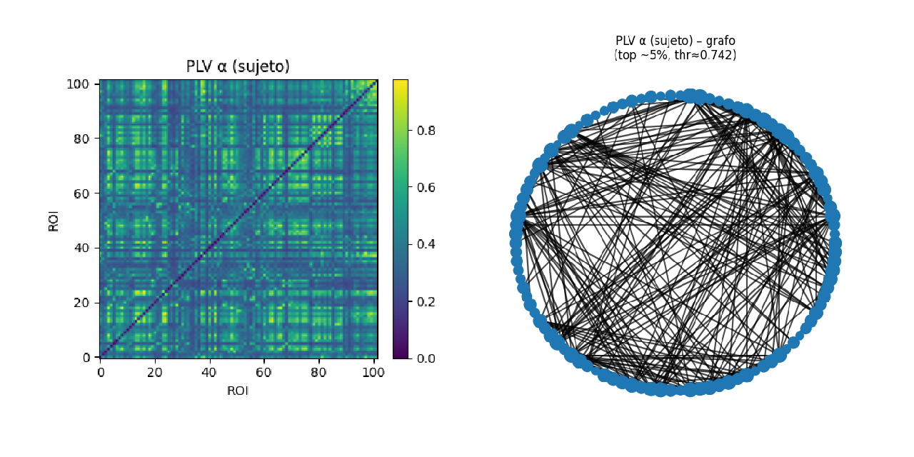
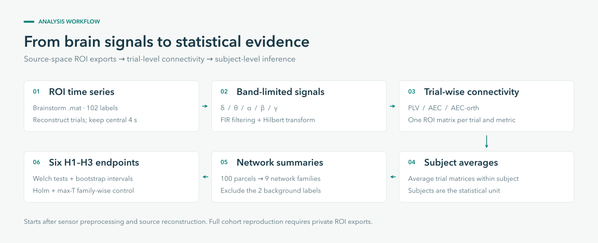

# MEG connectivity for Alzheimer's research

Python analysis of source-space magnetoencephalography (MEG) connectivity in
converters and non-converters, from Brainstorm ROI exports to network summaries
and predefined `H1–H3` tests.

[](https://github.com/enia-ardid/analysis_MEG_Alzheimer/actions/workflows/ci.yml)
[](environment.yml)
[](LICENSE)



*Alpha-band PLV for one subject: 35 trials and 102 ROIs. The graph retains
approximately the strongest 5% of connections. [Figure details](docs/visual_assets.md#original-notebook-figures).*

[Quickstart](#quickstart) · [Workflow](#workflow) · [Visual results](#visual-results) · [Scientific pipeline](#scientific-pipeline) · [Reproducibility](#reproducibility-limits) · [Citation](#citation)

## Overview

The pipeline reconstructs trials, computes band-limited connectivity and
averages matrices within subject before comparing groups. Methodological
sensitivity checks and an SNR simulation accompany the main analysis.

The workflow starts **after source reconstruction**, from exported ROI signals.
The public example data are synthetic; the original cohort data are private.
See [reproducibility limits](#reproducibility-limits) for the scope of the release.

| Analysis | Implementation |
| --- | --- |
| **5 frequency bands** | Delta, theta, alpha, beta and gamma; FIR filtering and Hilbert analytic signals |
| **3 connectivity measures** | Phase-locking value (PLV), amplitude-envelope correlation (AEC) and orthogonalized AEC (AEC-orth) |
| **100 parcels → 9 networks** | Schaefer-derived mapping; 2 background labels excluded from the 102-label export |
| **6 predefined endpoints** | TempPar-centered `H1–H3` composites; Welch tests, bootstrap intervals, Holm and max-T correction |
| **Public reproducibility** | Synthetic `.mat` examples, input validation, pinned scientific dependencies and a GitHub Actions test workflow |

## Quickstart

Run from a terminal with Python 3.12. The public example requires no private data.

```bash
git clone https://github.com/enia-ardid/analysis_MEG_Alzheimer.git
cd analysis_MEG_Alzheimer
python3.12 -m venv .venv
source .venv/bin/activate
python -m pip install --upgrade pip
python -m pip install -r requirements.txt
```

On Windows, activate with `.venv\Scripts\activate` instead.

<details>
<summary>Use Conda instead</summary>

From the repository root:

```bash
conda env create -f environment.yml
conda activate meg-alzheimer-paper
```

</details>

Validate the bundled input and run the public connectivity smoke test:

```bash
python run_validate_inputs.py \
  --data-root examples/brainstorm_roi_small/data \
  --require-paper-atlas

python -m unittest tests.test_public_smoke -v
```

The example contains 4 synthetic subjects, each with 2 trials, 102 ROI labels
and 8,000 samples per trial. The smoke test processes one subject's central
4-second window and checks the three `102 × 102` alpha-band connectivity
matrices. See the [example guide](examples/README.md).

## Workflow



Each trial contributes a connectivity matrix. Matrices are averaged **within
subject**, so subjects remain the statistical unit in group comparisons.

| Hypothesis | Predefined comparison |
| --- | --- |
| **H1 · Alpha coupling** | TempPar full composite, evaluated with AEC and AEC-orth |
| **H2 · Beta coupling** | TempPar inter-network composite, evaluated with AEC and AEC-orth |
| **H3 · Alpha gap** | `AEC − AEC-orth`, evaluated for the full and inter-network TempPar composites |

TempPar denotes the temporal-parietal network. The full composite includes
TempPar's within-network block and its between-network connections; the
inter-network composite uses only the latter. Definitions are fixed in
[strong_hypotheses.py](meg_alzheimer/strong_hypotheses.py).

## Visual results

The figures above show alpha-band PLV averaged over 35 trials from one subject,
using 102 ROIs and the central 4-second analysis window.

- [Alpha PLV matrix](docs/assets/original-alpha-plv-matrix.png): pairwise
  phase-locking values for that subject.
- [Alpha PLV graph](docs/assets/original-alpha-plv-graph.png): the same matrix,
  retaining approximately the strongest 5% of connections.

These exploratory figures come from the original notebook and predate the
current pipeline. They have not been recomputed because the private MATLAB
input is not included. The [figure documentation](docs/visual_assets.md#original-notebook-figures)
records their provenance.

The [supplementary Fisher-z comparison](supplementary/README.md) shows aggregation
sensitivity using the source CSVs provided with the repository.

## Code guide

| Area | Code to explore |
| --- | --- |
| MATLAB input handling and validation | [Dataset loader](meg_alzheimer/dataset.py) · [Input contract](docs/roi_input_contract.md) |
| Signal processing and connectivity | [FIR and Hilbert helpers](meg_alzheimer/signals.py) · [PLV, AEC and AEC-orth](meg_alzheimer/connectivity.py) |
| Cohort analysis | [Pipeline](meg_alzheimer/pipeline.py): subject matrices, network CSVs and configuration metadata |
| Statistical inference | [Endpoint definitions and family-wise tests](meg_alzheimer/strong_hypotheses.py) |
| Sensitivity analysis | [Robustness helpers](meg_alzheimer/robustness.py) · [Methodological validation](meg_alzheimer/methodological_validation.py) |
| Monte Carlo experiments | [SNR and trial-count simulation](simulation_aec_snr_bias/README.md) |
| Tests and figure generation | [Public tests](tests) · [CI workflow](.github/workflows/ci.yml) · [Figure and table builders](scripts/README.md) |

## Entry points

| Command | Purpose |
| --- | --- |
| [run_validate_inputs.py](run_validate_inputs.py) | Check a local ROI dataset against the input contract |
| [run_group_analysis.py](run_group_analysis.py) | Run cohort analysis from Brainstorm `.mat` files to group outputs |
| [run_strong_hypotheses.py](run_strong_hypotheses.py) | Rebuild the final `H1–H3` report from existing outputs |
| [run_paper_figures.py](run_paper_figures.py) | Generate the manuscript figure set from raw data or cached outputs |
| [run_methodological_validation.py](run_methodological_validation.py) | Rebuild the supplementary methodological checks |

## Typical usage

### Validate a new ROI time-series dataset

```bash
python run_validate_inputs.py --data-root data --require-paper-atlas
```

### Full batch: raw data to paper figures

```bash
python run_paper_figures.py --data-root data --output-root outputs_full_cohort
```

This command runs the cohort pipeline, refreshes the strong `H1-H3` outputs,
and regenerates the seven paper figures.

### Rebuild figures only from existing outputs

```bash
python run_paper_figures.py \
  --data-root data \
  --output-root outputs_full_cohort \
  --skip-group-analysis
```

### Run the scientific pipeline only

```bash
python run_group_analysis.py --data-root data --output-root outputs_full_cohort
```

### Refresh only the strong endpoint report

```bash
python run_strong_hypotheses.py --output-root outputs_full_cohort
```

## Scientific pipeline

<details>
<summary>Read the eight analysis steps and their source modules</summary>

### 1. Subject loading and trial reconstruction

Code:

- [meg_alzheimer/dataset.py](meg_alzheimer/dataset.py)

Brainstorm stores trials as one long stack of ROI blocks. The loader restores
the original `trial x ROI x time` layout and keeps the ROI labels and time axis
explicit.

### 2. Central window selection

Code:

- [meg_alzheimer/dataset.py](meg_alzheimer/dataset.py)

Each trial contains 8 seconds of data at 1000 Hz. The analysis keeps the
central 4-second segment (`2000:6000`) to stay away from filter edges.

### 3. Band-limited analytic signals

Code:

- [meg_alzheimer/signals.py](meg_alzheimer/signals.py)

Each cropped trial is filtered into delta, theta, alpha, beta, and gamma. The
filtering uses `scipy.signal.firwin` (`numtaps = 801`, Hamming window) and is
applied with `filtfilt` to preserve a symmetric phase response. The analytic
signal is then obtained with a Hilbert transform.

### 4. Trial-wise connectivity

Code:

- [meg_alzheimer/connectivity.py](meg_alzheimer/connectivity.py)

For every trial, band, and ROI pair, the pipeline computes `PLV`, `AEC`, and
`AEC-orth`. Negative values are kept. The main analysis averages on the raw
correlation scale; Fisher-z sensitivity is handled separately in the robustness
layer.

### 5. Within-subject averaging

Code:

- [meg_alzheimer/pipeline.py](meg_alzheimer/pipeline.py)

Trial-level matrices are averaged within subject. Subjects, not trials, are the
statistical unit in the group analysis.

### 6. ROI to network summary

Code:

- [meg_alzheimer/atlas.py](meg_alzheimer/atlas.py)

The source export contains 102 ROI labels:

- 100 Schaefer parcels
- 2 medial-wall/background labels

The two background labels are excluded from network summaries. The paper uses a
collapsed 9-network family:

- `Control`
- `Default`
- `DorsAttn`
- `Limbic`
- `SalVentAttn`
- `SomMot`
- `TempPar`
- `VisCent`
- `VisPeri`

This step is paper-specific. If another lab uses a different atlas, the
connectivity code still applies, but exact `H1-H3` reproduction requires
adapting:

- [meg_alzheimer/atlas.py](meg_alzheimer/atlas.py)
- [meg_alzheimer/strong_hypotheses.py](meg_alzheimer/strong_hypotheses.py)

### 7. Endpoint construction

Code:

- [meg_alzheimer/strong_hypotheses.py](meg_alzheimer/strong_hypotheses.py)

The confirmatory endpoint family is fixed: `H1_AEC`, `H1_AECorth`, `H2_AEC`,
`H2_AECorth`, `H3_gap_full`, and `H3_gap_inter`. `H3` is defined as
`AEC - AEC-orth` in alpha-band TempPar-centered composites.

### 8. Final inference

Code:

- [meg_alzheimer/strong_hypotheses.py](meg_alzheimer/strong_hypotheses.py)

The final report uses one-sided Welch tests, effect size `d`, bootstrap
intervals, Holm correction, and max-T permutation control across the six
endpoints.

</details>

## Input contract and portability

The pipeline expects Brainstorm-style MATLAB exports under `data/`:

```text
data/
├── C_p1.mat
├── C_p2.mat
├── C_p3.mat
├── NC_p1.mat
├── NC_p2.mat
└── NC_p3.mat
```

Current group discovery:

- `C_* -> Converter`
- `NC_* -> Non-converter`

Each subject struct is expected to contain:

- `Value`: ROI time series stacked trial by trial
- `Time`: sample axis
- `Atlas`: ROI labels

For a subject with `T` clean trials, `Value` has shape `(T * 102, 8000)`.

This code starts from source-space ROI time series that were exported upstream.
For the full structural contract, see:

- [docs/roi_input_contract.md](docs/roi_input_contract.md)

In practice:

- another lab can reuse the low-level pipeline if it can export ROI time series
  in the same Brainstorm-like struct format
- exact reproduction of the paper endpoints also requires the same
  Schaefer-style ROI naming used by `meg_alzheimer/atlas.py`

Validate a new dataset before running the full workflow:

```bash
python run_validate_inputs.py --data-root data --require-paper-atlas
```

For a public smoke example that follows the same struct contract, see:

- [examples/README.md](examples/README.md)

## Paper figure set

<details>
<summary>Browse manuscript figures, scripts and required inputs</summary>

The main figure set is:

- `fig_pipeline_overview`
- `fig_qc_valid_trials`
- `fig_network_heatmaps_alpha`
- `fig_network_heatmaps_beta`
- `fig_composite_breakdown`
- `fig_endpoints_distributions`
- `fig_sensitivity_trials`

These are generated by:

- [scripts/final_figures/build_pipeline_overview.py](scripts/final_figures/build_pipeline_overview.py)
- [scripts/final_figures/build_qc_valid_trials_figure.py](scripts/final_figures/build_qc_valid_trials_figure.py)
- [scripts/final_figures/build_network_heatmaps.py](scripts/final_figures/build_network_heatmaps.py)
- [scripts/final_figures/build_composite_breakdown.py](scripts/final_figures/build_composite_breakdown.py)
- [scripts/final_figures/build_endpoints_main_figure.py](scripts/final_figures/build_endpoints_main_figure.py)
- [scripts/final_figures/build_trials_threshold_sensitivity.py](scripts/final_figures/build_trials_threshold_sensitivity.py)

`build_endpoints_main_figure.py` also writes the paper-ready endpoint table.

Figure-to-script map:

| Figure | Script | Main inputs |
| --- | --- | --- |
| `fig_pipeline_overview` | `scripts/final_figures/build_pipeline_overview.py` | documented workflow only |
| `fig_qc_valid_trials` | `scripts/final_figures/build_qc_valid_trials_figure.py` | raw `.mat` files + `subjects.csv` |
| `fig_network_heatmaps_alpha` | `scripts/final_figures/build_network_heatmaps.py` | saved subject matrices under `outputs_full_cohort/subjects/` |
| `fig_network_heatmaps_beta` | `scripts/final_figures/build_network_heatmaps.py` | saved subject matrices under `outputs_full_cohort/subjects/` |
| `fig_composite_breakdown` | `scripts/final_figures/build_composite_breakdown.py` | `subject_network_means.csv` |
| `fig_endpoints_distributions` | `scripts/final_figures/build_endpoints_main_figure.py` | `subject_network_means.csv` + `endpoint_tests.csv` |
| `fig_sensitivity_trials` | `scripts/final_figures/build_trials_threshold_sensitivity.py` | cached trial-level endpoint table or rebuilt endpoint DataFrame |

</details>

## Supplementary simulation

The repository also includes a separate simulation package:

- [simulation_aec_snr_bias](simulation_aec_snr_bias)

It addresses one specific question: whether realistic SNR and trial-count
differences could bias `AEC-orth` enough to account for the observed `H3` gap.

## Tests

The public test suite avoids private data and checks only logic that can be run
from synthetic inputs or from the bundled example dataset.

```bash
python -m unittest discover -s tests -v
```

The tests cover:

- dataset loading helpers
- atlas/network collapsing
- public example-dataset smoke execution
- signal-processing helpers
- endpoint reconstruction logic
- trial-threshold sensitivity bookkeeping

## Repository layout

<details>
<summary>Browse the repository tree</summary>

```text
.
├── README.md
├── CITATION.cff
├── .github/
│   └── workflows/
│       └── ci.yml
├── docs/
│   ├── roi_input_contract.md
│   ├── visual_assets.md
│   └── assets/
├── environment.yml
├── examples/
│   ├── README.md
│   ├── build_example_dataset.py
│   └── brainstorm_roi_small/
│       └── data/
├── requirements.txt
├── tests/
├── run_validate_inputs.py
├── run_group_analysis.py
├── run_strong_hypotheses.py
├── run_paper_figures.py
├── run_methodological_validation.py
├── simulation_aec_snr_bias/
├── supplementary/
│   ├── README.md
│   ├── source_tables/
│   ├── tables/
│   └── figures/
├── meg_alzheimer/
│   ├── __init__.py
│   ├── atlas.py
│   ├── connectivity.py
│   ├── dataset.py
│   ├── methodological_validation.py
│   ├── pipeline.py
│   ├── qc.py
│   ├── robustness.py
│   ├── signals.py
│   ├── stats.py
│   ├── strong_hypotheses.py
│   └── viz.py
└── scripts/
    ├── README.md
    ├── figures/
    ├── final_figures/
    ├── final_tables/
    └── supplementary/
```

</details>

## Reproducibility limits

- The repository does not document baseline diagnosis, follow-up duration, eyes
  open versus closed, or MEG vendor because those fields are not available in
  the accessible files.
- Age and sex were not available as subject-level values in the raw structs
  accessible to this codebase.
- Sensor-space preprocessing and source reconstruction are upstream steps. This
  repository starts from already exported source-space ROI time series.
- Exact reproduction of the paper-level endpoint family requires the same
  Schaefer-style network naming convention encoded in
  [meg_alzheimer/atlas.py](meg_alzheimer/atlas.py). Other ROI atlases are still
  compatible with the low-level signal-processing code, but not with the paper
  endpoint definitions without explicit adaptation.

The public release supports inspection of the analysis code, execution on
synthetic inputs and access to selected aggregate supplementary results. Full
cohort and manuscript reproduction requires the private ROI exports and derived
outputs.

Generated files under `figures/`, `tables/` and `outputs_full_cohort/` remain local
artifacts. The Fisher-z source CSVs, LaTeX tables and rendered table figures are
versioned under [supplementary/](supplementary/README.md). The presentation assets
under `docs/assets/` are documented in [visual_assets.md](docs/visual_assets.md).

## Citation

Created by [Enia Ardid](https://github.com/enia-ardid). If you use the code,
please cite the repository using [CITATION.cff](CITATION.cff) or GitHub's
**Cite this repository** menu. The software is released under the [MIT license](LICENSE).
