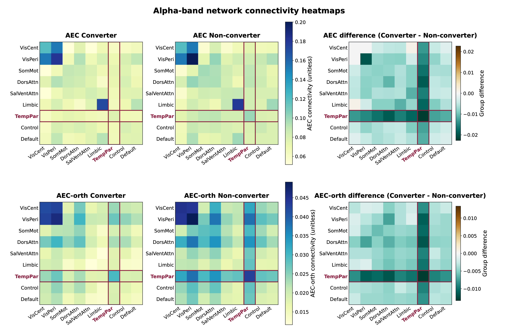
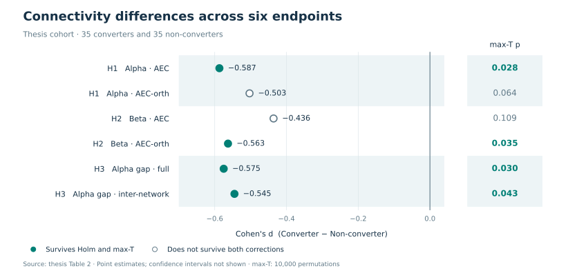

# MEG connectivity in Alzheimer's disease

**Resting-state MEG connectivity in mild cognitive impairment.**

[](https://github.com/enia-ardid/analysis_MEG_Alzheimer/actions/workflows/ci.yml)
[](environment.yml)
[](LICENSE)

[Results](#results) · [Method](#method) · [Quickstart](#quickstart) · [Code guide](#code-guide) · [Reproducibility](#reproducibility) · [Citation](#citation)

This project studies resting-state magnetoencephalography (MEG) connectivity in
people with mild cognitive impairment, comparing those who progressed to
dementia (**converters**) with those who remained stable (**non-converters**).
It combines signal processing, network summaries and statistical inference in
a Python pipeline developed for a Physics BSc thesis at Universidad Complutense
de Madrid.

| Study cohort | Brain parcellation | Statistical comparison |
| :--- | :--- | :--- |
| **70 participants** · 35 per group | **100 parcels → 9 networks** | **6 endpoints** · H1–H3 |

[](docs/assets/thesis-alpha-networks.png)

*Alpha-band connectivity from the thesis cohort. Columns show converters,
non-converters and their difference; rows compare AEC with orthogonalized AEC.
TempPar, the temporal-parietal network, is outlined. These are descriptive group
means. [Figure source and interpretation](docs/results.md#alpha-band-network-connectivity).*

## Results

The thesis found a smaller **AEC − AEC-orth gap** in converters around the
temporal-parietal network in the alpha band. Both H3 endpoints survived Holm
and max-T correction. H1 and H2 received partial support: one of the two
endpoints in each hypothesis survived both corrections.

[](docs/results.md#six-endpoint-summary)

*Effect sizes use the Converter − Non-converter convention. Negative values
indicate lower values in converters. Points show estimates without confidence
intervals; the adjacent p-values are max-T corrected. These cohort associations
do not establish individual clinical prediction.*

The [results gallery](docs/results.md) includes the network-composite breakdown,
the full endpoint table and a comparison of mean-r versus Fisher-z aggregation.
The study figures and statistics are retained from the thesis; their
[provenance and analysis settings](docs/visual_assets.md) are documented separately.

## Method


The implementation starts with **source-space ROI time series exported from
Brainstorm**. Sensor preprocessing and source reconstruction were performed
upstream by the laboratory. This repository implements data loading and
validation, FIR filtering, Hilbert analysis, PLV/AEC/AEC-orth connectivity,
network aggregation, inference and figure generation.

Connectivity matrices are averaged **within each subject** before comparing
groups. Inference combines one-sided Welch tests, effect sizes, bootstrap
intervals, Holm correction and max-T permutations across the six endpoints.

| Hypothesis | Comparison |
| --- | --- |
| **H1 · Alpha coupling** | TempPar intra- and inter-network composite, using AEC and AEC-orth |
| **H2 · Beta coupling** | TempPar inter-network composite, using AEC and AEC-orth |
| **H3 · Alpha gap** | AEC − AEC-orth for the full and inter-network TempPar composites |

[Analysis reference](docs/analysis_reference.md) · [Input contract](docs/roi_input_contract.md) · [SNR simulation](simulation_aec_snr_bias/README.md)

## Quickstart

The public example uses synthetic data and requires no access to the study cohort.
Run these commands with Python 3.12:

```bash
git clone https://github.com/enia-ardid/analysis_MEG_Alzheimer.git
cd analysis_MEG_Alzheimer
python3.12 -m venv .venv
source .venv/bin/activate
python -m pip install -r requirements.txt

python run_validate_inputs.py \
  --data-root examples/brainstorm_roi_small/data \
  --require-paper-atlas

python -m unittest tests.test_public_smoke -v
```

On Windows, activate the environment with `.venv\Scripts\activate`.

The example contains four synthetic subjects with two trials each. The smoke
test loads one subject, selects the central four-second window and computes
the three **102 × 102 alpha-band connectivity matrices**.
[Example details](examples/README.md).

<details>
<summary>Conda installation</summary>

```bash
conda env create -f environment.yml
conda activate meg-alzheimer-paper
```

</details>

### Run on a compatible dataset

```bash
python run_validate_inputs.py --data-root data --require-paper-atlas
python run_group_analysis.py --data-root data --output-root outputs_full_cohort
```

To run the analysis and build the complete manuscript figure set:

```bash
python run_paper_figures.py --data-root data --output-root outputs_full_cohort
```

[Commands and figure inputs](docs/analysis_reference.md#paper-figure-set) · [Figure and table scripts](scripts/README.md)

## Code guide

| Area | Implementation |
| --- | --- |
| Data loading and validation | [dataset.py](meg_alzheimer/dataset.py) · [run_validate_inputs.py](run_validate_inputs.py) |
| Signal processing | [signals.py](meg_alzheimer/signals.py) |
| Connectivity measures | [connectivity.py](meg_alzheimer/connectivity.py) |
| Cohort workflow | [pipeline.py](meg_alzheimer/pipeline.py) · [atlas.py](meg_alzheimer/atlas.py) |
| Endpoint definitions and inference | [strong_hypotheses.py](meg_alzheimer/strong_hypotheses.py) |
| Sensitivity analysis | [robustness.py](meg_alzheimer/robustness.py) · [methodological_validation.py](meg_alzheimer/methodological_validation.py) |
| Monte Carlo experiments | [simulation_aec_snr_bias](simulation_aec_snr_bias/README.md) |
| Tests | [tests](tests) · [GitHub Actions](.github/workflows/ci.yml) |

Run the public test suite:

```bash
python -m unittest discover -s tests -v
```

Tests cover input loading, atlas mapping, signal processing, endpoint
construction, statistical regression checks and agreement between the
simulation and cohort connectivity measures.

## Reproducibility

**Available publicly:** analysis code, pinned scientific dependencies, synthetic
ROI examples, selected aggregate study figures and supplementary summary tables.

**Required for cohort reproduction:** the private Brainstorm ROI exports and
their study metadata. The synthetic examples demonstrate execution; they do
not reproduce the thesis findings. Participant records and the full thesis PDF
are not distributed here.

The thesis reports baseline mild cognitive impairment and age/sex matching by
study design. Individual demographic and clinical fields are absent from the
public input examples. Follow-up details and upstream preprocessing require
the original study documentation. The thesis and current defaults also differ
in their documented beta band and permutation count; see
[analysis settings](docs/visual_assets.md#analysis-settings).

## Citation

Developed by [Enia Ardid](https://github.com/enia-ardid) for the 2026 Physics BSc
thesis *Caracterización de la progresión del Alzheimer mediante conectividad
funcional en MEG*, supervised by Gianluca Susi at Universidad Complutense de Madrid.

To cite the software, use [CITATION.cff](CITATION.cff) or GitHub's **Cite this
repository** menu. Code is released under the [MIT license](LICENSE).
