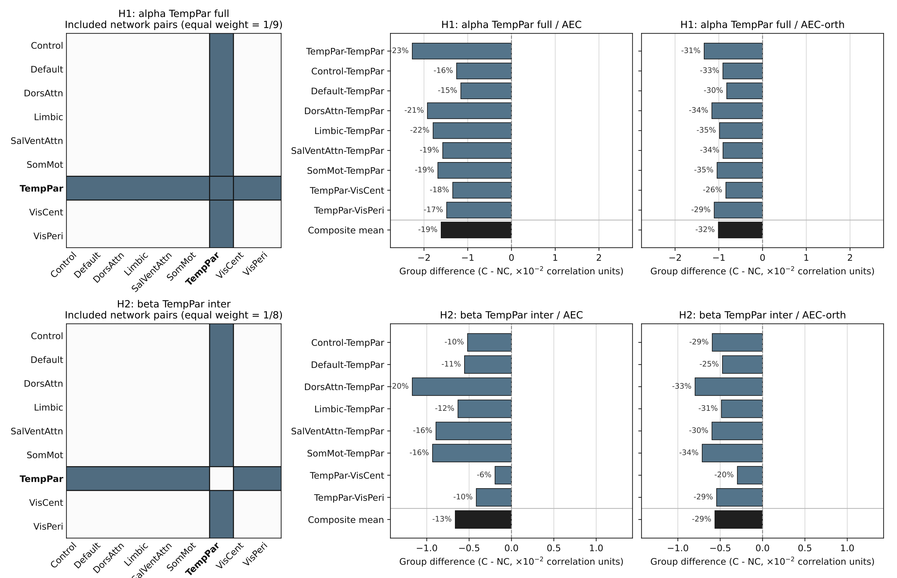
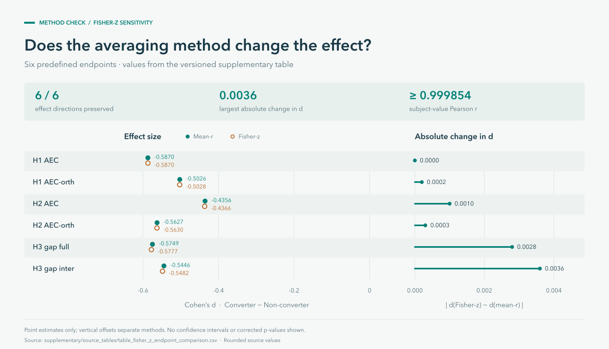

# Study results

[Back to the project](../README.md) · [Methods](analysis_reference.md) · [Figure provenance](visual_assets.md)

The 2026 thesis examined source-space MEG connectivity in 70 participants with
mild cognitive impairment: 35 who progressed to dementia and 35 who remained
stable. The figures below show aggregate results from that cohort. They retain
the thesis analysis and are separate from the public synthetic examples.

## Alpha-band network connectivity

**Reading the figure.** The first two columns show group means, with a shared
color scale within each metric. The third shows Converter − Non-converter
differences. TempPar is outlined on both axes. The darker negative differences
around TempPar motivate the focused endpoint comparisons below. Heatmap colors
encode connectivity values and differences, not statistical significance.

Source: thesis Figure 3a, printed page 16 (PDF page 17).

## Six-endpoint summary

The six endpoints compare groups using the same subject-level analysis unit.
Negative effect sizes indicate lower values in converters. Filled points mark
endpoints that survived both Holm and max-T correction. The figure shows point
estimates; confidence intervals are not supplied in the source summary table.

| Endpoint | Converter mean | Non-converter mean | Cohen's d | One-sided p | max-T p | Both corrections |
| --- | ---: | ---: | ---: | ---: | ---: | :---: |
| H1 · Alpha AEC | 0.0688 | 0.0849 | −0.587 | 0.0083 | 0.028 | Yes |
| H1 · Alpha AEC-orth | 0.0218 | 0.0319 | −0.503 | 0.0196 | 0.064 | No |
| H2 · Beta AEC | 0.0439 | 0.0505 | −0.436 | 0.0365 | 0.109 | No |
| H2 · Beta AEC-orth | 0.0135 | 0.0191 | −0.563 | 0.0109 | 0.035 | Yes |
| H3 · Alpha gap, full | 0.0470 | 0.0530 | −0.575 | 0.0095 | 0.030 | Yes |
| H3 · Alpha gap, inter-network | 0.0469 | 0.0525 | −0.545 | 0.0130 | 0.043 | Yes |

All six endpoints survived Holm correction in the thesis report; four also
survived max-T. **H3 received full support**, with both gap endpoints surviving
both corrections. H1 and H2 received partial support.

Source: thesis Table 2, printed page 18 (PDF page 19), using its displayed
precision. [Download the aggregate table](../supplementary/source_tables/table_thesis_endpoints.csv).
The reported max-T calculation used 10,000 permutations across the six endpoints.

## Contributions from individual networks

The masks on the left identify the network blocks entering each composite.
H1 includes TempPar's within-network block and eight between-network blocks;
H2 includes only the eight between-network blocks. Each block has equal weight.

Bars show mean differences between converters and non-converters. Percentage
labels express those differences relative to the non-converter mean. The bars
describe contributions to the composite; they are not separate corrected
significance tests.

Source: thesis Figure 5, printed page 19 (PDF page 20). The thesis describes beta
as 12–30 Hz, while the current code defaults to 13–30 Hz. The original execution
configuration is needed to resolve this difference; the figure is retained as
reported in the thesis.

## Aggregation sensitivity

Switching between mean-r and Fisher-z aggregation preserved the direction of all
six endpoint effect sizes. The largest absolute change in Cohen's d was
**0.0036**, calculated from the rounded supplementary table. This comparison
addresses aggregation sensitivity; it does not establish clinical predictive
performance or replace the family-wise tests above.

[Source tables and regeneration](../supplementary/README.md) · [Calculation details](visual_assets.md#effect-size-comparison)

## Interpretation and scope

The smaller alpha AEC − AEC-orth gap is the most consistent hypothesis-level
finding in the thesis. It describes how the estimated connectivity changes
after orthogonalization. The analysis alone cannot distinguish physiological
changes from effects of source mixing, signal-to-noise conditions or other
measurement factors. Independent cohorts and additional clinical and structural
information would be needed to assess its wider relevance.

The public release supports inspection of the methods and execution on synthetic
inputs. Reproducing the study figures requires the private cohort exports.
