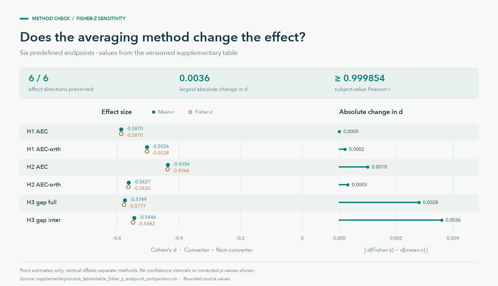

# Supplementary results

This directory contains aggregate thesis results and the Fisher-z sensitivity
tables. The [results gallery](../docs/results.md) puts them alongside the cohort
network figures.

## Thesis endpoint summary

[table_thesis_endpoints.csv](source_tables/table_thesis_endpoints.csv) reproduces
the displayed values in thesis Table 2: group means, differences, effect sizes,
one-sided p-values, max-T p-values and Holm decisions for the six endpoints.
It contains aggregate statistics for 35 participants per group. The thesis
max-T analysis used 10,000 permutations; the table retains its rounding.

Rebuild its presentation figure with:

```bash
python scripts/figures/build_project_assets.py
```

## Visual summary

[](../docs/assets/fisher-z-sensitivity.svg)

This figure uses the existing
[endpoint comparison CSV](source_tables/table_fisher_z_endpoint_comparison.csv).
It shows point estimates and changes calculated from the rounded CSV values;
it does not show confidence intervals or family-wise corrected p-values.
See [figure provenance](../docs/visual_assets.md) for the source columns and
calculation.

## Contents and regeneration

Contents:

- `source_tables/`: source CSVs used to build the supplementary tables
- `tables/`: LaTeX tables ready for `\input{...}`
- `figures/`: optional PDF/PNG renders of those same tables

Regenerate the Fisher-z tables and their renders from the repository root with:

```bash
python scripts/supplementary/make_fisher_z_tables.py
```

Explicit full command:

```bash
python scripts/supplementary/make_fisher_z_tables.py \
  --input-dir supplementary/source_tables \
  --supplementary-dir supplementary/tables \
  --figure-dir supplementary/figures
```
